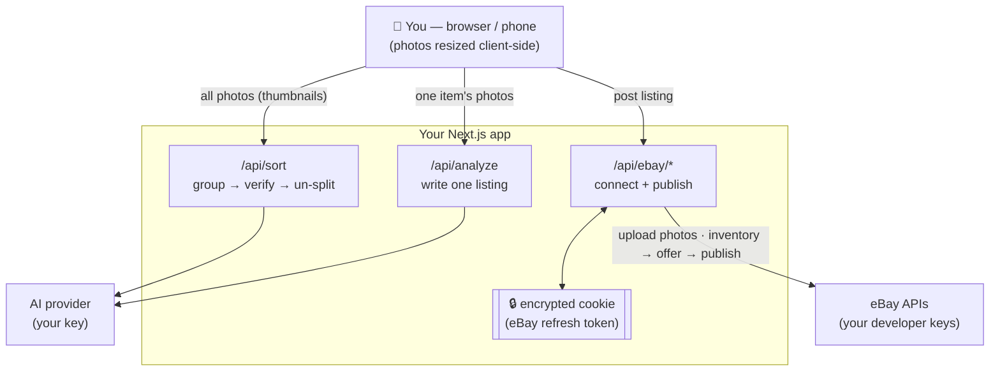

# Listing Writer 🪄

A free, open-source web app for resellers. **Dump in a pile of item photos →
it sorts them into separate items → writes a full eBay listing for each →
posts them to eBay.** This customized version runs locally or on your own
private host; works on your computer and your phone.

It's **bring-your-own-keys**: you plug in your own AI key (Anthropic or OpenAI)
and your own eBay developer keys, so you're in full control and there's no
middleman.

---

## What it does

- 📸 Upload a whole batch of photos at once
- 🔀 Auto-sorts them into separate items (group → verify → un-split)
- 🏷️ Assigns numeric SKUs with continuation across batches and supports bin tracking
- 🤖 Writes a title, description, item specifics, condition, and suggested price
- ✍️ Everything is editable before you post
- 🚀 Posts straight to eBay — one item or the whole batch
- 📋 Or export everything as CSV / JSON
- 💾 Save and reopen named batches on the server
- 🖨️ Print inventory labels, rotate photos, and choose listing photos
- 📝 Stage eBay offers and manage them before publishing
- 🔒 Your keys live in environment variables, never in the code

---

## What you'll need (all free to start)

1. **An AI API key** — Anthropic or OpenAI, for the AI that writes listings.
   Anthropic keys come from <https://console.anthropic.com/> and OpenAI keys
   come from <https://platform.openai.com/api-keys>.
2. **An eBay developer keyset** — to post listings. Free at
   <https://developer.ebay.com/>. You'll need the **App ID**, **Cert ID**, and a
   **RuName** (explained below). *Only needed for posting — sorting and writing
   work without it.*
3. **A hosting option** — run locally, or use a host with persistent writable
   storage for saved batches and SKU state. See *Storage and hosting* below.
4. **Node.js** installed on your computer — <https://nodejs.org/> (the "LTS" version).

> There are two ways to set this up. **Not a coder? Use the Quick Start.**
> Comfortable in a terminal? Skip to *Setup for developers*.

---

## 🚀 Quick Start (no coding required)

You can get your own copy running without ever opening a terminal.

The deployment button below copies the original upstream project. It does not
include this folder's customizations. To deploy this version, upload your own
copy and use a persistent host if you rely on saved batches or SKU continuation.

**1. Make your free accounts and grab your keys.**
   - AI key: Anthropic at <https://console.anthropic.com/> or OpenAI at <https://platform.openai.com/api-keys>.
   - eBay developer keyset at <https://developer.ebay.com/> (do this part later if you only want to write listings, not post them).
   - A Vercel account at <https://vercel.com/> — sign up **with GitHub** (it'll make a free GitHub account too if you don't have one).

**2. Deploy your own copy in a few clicks.**
   Click the button (it copies this project to your own GitHub and deploys it on Vercel):

   [](https://vercel.com/new/clone?repository-url=https://github.com/ashnicholes-droid/hahm-ebay-lister)

   Set **both** of these environment variables. Vercel sometimes asks for them
   during the deploy — but **its current flow often doesn't ask at all**. If you
   weren't prompted, deploy first, then add them under **your project →
   Settings → Environment Variables** and hit **Redeploy** (Deployments → ⋯ →
   Redeploy):
   - `AI_PROVIDER` — use `anthropic` or `openai`.
   - `ANTHROPIC_API_KEY` or `OPENAI_API_KEY` — whichever matches `AI_PROVIDER`.
   - `APP_SECRET` — any access code you make up (a memorable phrase works). A
     deployed app **won't run without this**: it stops strangers from spending
     your AI credits, and every AI action returns an error until it's set.

   (You can add the eBay variables later.) After deploying you'll get a web
   address like `https://your-app.vercel.app`.

**3. Bookmark your app** on your computer and add it to your phone's home
   screen. You can start sorting and writing listings immediately.

**4. To enable posting to eBay** (optional), follow *Set up eBay posting* below
   using your new web address, then add the eBay values in
   **Vercel → your project → Settings → Environment Variables** and redeploy.

That's it — no terminal, no code editing. Everything else below is for people
who want to run it locally or tinker.

---

## Setup for developers (command line)

### 1. Get the code
```bash
git clone https://github.com/ashnicholes-droid/hahm-ebay-lister.git
cd hahm-ebay-lister
npm install
```

### 2. Try it locally (optional)
Create a file called `.env.local` (copy from `.env.example`) and add at least
your AI provider and API key:
```bash
cp .env.example .env.local
# then edit .env.local and set AI_PROVIDER plus the matching API key
npm run dev
```
Open <http://localhost:3001>. You can sort and write listings right away.
(eBay posting needs the eBay setup below + a deployed URL.)

### 3. Deploy to Vercel
The easiest path:
```bash
npm i -g vercel     # one time
vercel login        # one time
vercel --prod       # deploys; gives you a URL like https://your-app.vercel.app
```
Then add your environment variables in the Vercel dashboard
(**Project → Settings → Environment Variables**) — see the full list below —
and redeploy with `vercel --prod`.

> Prefer no terminal? You can also push this repo to GitHub and import it at
> vercel.com → "Add New Project", then add the env vars there.

### 4. Set up eBay posting (optional, for the "Post to eBay" button)
1. At <https://developer.ebay.com/> create a **Production keyset**. Note the
   **App ID (Client ID)** and **Cert ID (Client Secret)**.
2. Under that keyset → **User Tokens** → **Add eBay Redirect URL (RuName)**.
   Set, using your deployed URL:
   - **Auth accepted URL:** `https://your-app.vercel.app/api/ebay/callback`
   - **Auth declined URL:** `https://your-app.vercel.app/?ebay=declined`
   - **Privacy policy URL:** `https://your-app.vercel.app/privacy`
   - Choose **OAuth** (not Auth'n'Auth).
3. Copy the generated **RuName** — the short identifier (like `Name-XXXX-XXXX-XXXX`),
   **not** the long "eBay Production Sign In (OAuth)" URL shown on the same page.
4. Put all the values into Vercel's env vars (below) and redeploy.
5. On the live site, click **Connect eBay**, approve on eBay, and paste the URL
   from eBay's confirmation page back into the app. Done (lasts ~18 months).

> **"Marketplace account deletion" compliance.** Describe your actual deployment
> and stored data honestly when completing eBay's developer requirements. This
> version saves listing and eBay workflow data in server-side batches, so the
> original project's claim that it persists no eBay data does not apply. Review
> eBay's current requirements before claiming an exemption.

---

## Environment variables

| Variable | Required | What it is |
|---|---|---|
| `AI_PROVIDER` | optional | `anthropic` by default. Set to `openai` to use the OpenAI API instead. |
| `ANTHROPIC_API_KEY` | required when `AI_PROVIDER=anthropic` | Your Anthropic API key. |
| `OPENAI_API_KEY` | required when `AI_PROVIDER=openai` | Your OpenAI API key. |
| `OPENAI_SORT_MODEL` / `OPENAI_ANALYSIS_MODEL` / `OPENAI_ROUTER_MODEL` / `OPENAI_ASPECT_MODEL` | optional | OpenAI model overrides. Defaults are `gpt-5.6-luna` for sorting/routing and `gpt-5.6-terra` for listing/aspect writing. |
| `APP_SECRET` | ✅ for deployed apps | Access code protecting the AI endpoints so strangers can't spend your AI credits. **A deployed (production) app fails closed without it** — every AI route returns an error until it's set. Asked for once per device, then remembered. Optional only for local dev. |
| `EBAY_CLIENT_ID` | for posting | eBay App ID |
| `EBAY_CLIENT_SECRET` | for posting | eBay Cert ID |
| `EBAY_RU_NAME` | for posting | Your eBay RuName — the short `Name-XXXX-XXXX-XXXX` identifier, **not** the long "Sign In (OAuth)" URL |
| `SESSION_SECRET` | for posting | Random string to encrypt your eBay token. Generate: `node -e "console.log(require('crypto').randomBytes(32).toString('hex'))"` |
| `APP_URL` | for posting | Your deployed URL, e.g. `https://your-app.vercel.app` |
| `EBAY_LOCATION_POSTAL_CODE` | when creating an inventory location | Your actual shipping-location ZIP. Configure it or use an existing eBay inventory location; no placeholder ZIP is supplied. |
| `EBAY_DEFAULT_PACKAGE_WEIGHT_OZ` | optional | Default package weight in ounces (16 = 1 lb) sent to eBay so **calculated-shipping** policies can publish (avoids eBay error 25020). Overrides the built-in per-item-class defaults (coats, shoes, media, etc.). Editable per listing on eBay. |
| `EBAY_DEFAULT_PACKAGE_LENGTH_IN` / `_WIDTH_IN` / `_HEIGHT_IN` | optional | Default package dimensions in inches. Override the per-item-class defaults. |
| `EBAY_STRICT_QUALITY` | optional | Set to `1` to **stop** a publish when eBay's item-specifics schema can't be retrieved, instead of publishing with a warning. |
| `PRICE_MARKUP_PERCENT` | optional | Storewide markup applied to every **auto-suggested** price (the AI estimate and the comps "use median" button) before you review it — for sellers who run a permanent store-level sale that discounts everything. `40` lists at 1.4×. The marked-up price is what you see on the card, and you can still edit it; manually typed prices are never touched. Note the math: +40% then a 40%-off sale nets 84% of the original — to land back on the suggested price after an X%-off sale, set `100·X/(100−X)` (≈`66.7` for 40% off). Unset = no markup. |
| `EBAY_MARKETPLACE_ID` / `EBAY_CATEGORY_TREE_ID` / `EBAY_CURRENCY` | optional, experimental | Marketplace override, e.g. `EBAY_GB` / `3` / `GBP` for eBay UK — set all three together. Defaults: `EBAY_US` / `0` / `USD`. ⚠️ **The US site is the only tested marketplace.** Known gaps on other sites: condition-tier and size-standardization handling were validated against eBay US, and the UI shows prices with a `$` symbol. After changing marketplace, regenerate the offline category map: `npx tsx scripts/refresh-category-map.ts`. |

**Never commit real keys.** `.env.local` is gitignored; production keys live in
Vercel only.

---

## How it works (for the curious)



- **Frontend** (`app/`): the upload → sort → review → write → post wizard.
  Photos are shrunk in your browser before upload.
- **`/api/sort`**: groups photos into items (AI), with verify + un-split passes.
- **`/api/analyze`**: writes a listing for one item from its photos.
- **`/api/ebay/*`**: OAuth connect (encrypted-cookie token), photo uploads, and
  the inventory→offer→publish flow, including staged-offer management.
- **Stack**: Next.js (App Router), React, and TypeScript, with Anthropic and
  OpenAI provider support and selectable models.

## AI models and cost estimates

The balanced Claude defaults use **Sonnet 5.5** for sorting, classification,
listing writing, and item specifics. Sorting and classification use low effort;
listing writing and specifics use medium effort. Sonnet 5.5 uses
`between_tools` thinking, without upfront thinking for extraction calls that
have no tools. A failed extraction can make at most one extra attempt with the
same model; it does not automatically switch to a premium model.

Choose **Recommended default** in the model selector to clear an explicit model
override and follow these defaults. Existing saved model selections are retained.
**Opus 5.5** remains a manual option. **Haiku 5.5** is an optional sorting-only
trial; its sorting quality has not been established for this app. The model list
handles pagination from the provider's models API. Anthropic integration uses
SDK version `0.132.1`.

Per-item and batch cost estimates use usage reported by completed AI calls and
standard global model rates as of **October 8, 2026**. These are estimates, not
invoices. Timeouts, missing usage, and unknown model prices show cost as
unavailable. A request whose response is lost can still be billed by the provider
without a recoverable usage report. Older saved batches are not retroactively
estimated.

## Review and publishing

Click **Prepare for eBay** to retrieve the category requirements and place item
specifics and an explicit condition on the listing card for review. Review those
values before the next stage or publish action. The publish flow does not silently
change the reviewed category or condition to work around an eBay error.

All selected listing photos must upload successfully before staging or publishing.
Single-item listings, including books, support **up to 24 selected photos**.
Saved batches
preserve upload receipts and attempt identifiers to help recovery after an
interrupted request. Publishing does not blindly repeat non-idempotent requests;
inspect the resulting eBay state when an outcome is uncertain before trying again.

## Photo quality and importing

Newly added photos have a separate eBay JPEG derivative with a longest edge of
up to **2400 pixels**, without enlarging smaller originals. Bounded compression
keeps each upload manageable. AI analysis still uses the **1024-pixel** image,
and sorting and previews still use the **360-pixel** thumbnail, so higher eBay
photo quality does not enlarge the AI inputs.

Importing processes at most two photos at a time and retains successful files
when another file fails. Navigation is held while intake finishes. Older saved
batches retain their previous photo resolution: re-add the original photos to
benefit from the higher-resolution eBay derivatives.

Photo uploads use eBay's current Media API instead of the retired Trading
`UploadSiteHostedPictures` method. The existing `sell.inventory` permission is
sufficient; no additional OAuth scope is required for this migration. See eBay's
[image guide](https://developer.ebay.com/api-docs/sell/static/inventory/managing-image-media.html)
and [retirement notice](https://www.developer.ebay.com/devzone/xml/Docs/Reference/ebay/UploadSiteHostedPictures.html).

## Storage and hosting

Named saved batches, photos, listing edits, eBay workflow metadata, and SKU
continuation state are stored locally on the server under `data/`. Back up that
directory along with your configuration. A stale SKU lock is recovered
automatically only when its owning local process is no longer running.

Higher-resolution eBay JPEGs are private files in `data/photo-assets/`, with
references in saved-batch metadata rather than large inline copies. Back up
`data/photo-assets/` together with `data/batches/`; restoring only batch JSON
does not restore those photos. Back up the entire `data/` directory, including
`photo-cleanup.json`, to preserve the cleanup tracking state as well.

Unreferenced photo assets are automatically removed **seven days after they are
first found unreferenced**. Photos referenced by active, archived, duplicated, or
legacy saved batches are retained regardless of whether the items are live on
eBay. Saving or reusing a reference resets its cleanup age. Newly imported assets
that have not yet been saved in a batch also receive a seven-day grace period.

After the first authenticated use of the app following a server restart, the app
checks for unreferenced assets hourly while the server is running. It also scans
after a batch deletion or another change that removes an asset's last reference.
These checks run inside the app; they do not use a Codex scheduled job or a cloud
service. Unreadable batch files or cleanup metadata pause deletion, and the data
directory must use ordinary local folders with hard-link support for the shared
save/cleanup lock (use NTFS on Windows). Cleanup is not a deleted-batch undo
feature; keep backups for recovery.

Run on a local machine or a host with persistent writable storage to retain that
data between restarts. Vercel's serverless filesystem is not durable shared
storage: local batch persistence and SKU locking should not be relied on across
deployments or multiple instances. A durable database/object-storage integration
would be needed for that setup. Cloud background drafting has not been imported.

## Development checks

Run `npm test` for the regression suite and `npm run typecheck` for TypeScript
checks. Run `npm run build` to check the production build. Automated checks do
not replace reviewing a prepared listing and validating your own eBay account,
policies, and shipping location before publishing.

---

## Costs

- **AI provider**: sorting and writing are billed to your own Anthropic or OpenAI key.
- **eBay**: normal eBay selling fees apply to listings you post.
- **Hosting**: depends on your provider; persistent storage is needed for saved batches.

---

## License

**Functional Source License (FSL-1.1-MIT)** — see [LICENSE](LICENSE).

In plain English: **free to use, modify, and self-host** — including for your
own reselling business. The one thing you *can't* do is sell this software or
offer it as a competing paid product/service. Two years after each release, that
restriction lifts and it becomes plain MIT. Use it, fork it, share it — just
don't resell it.
